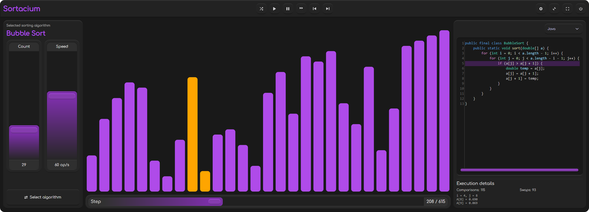
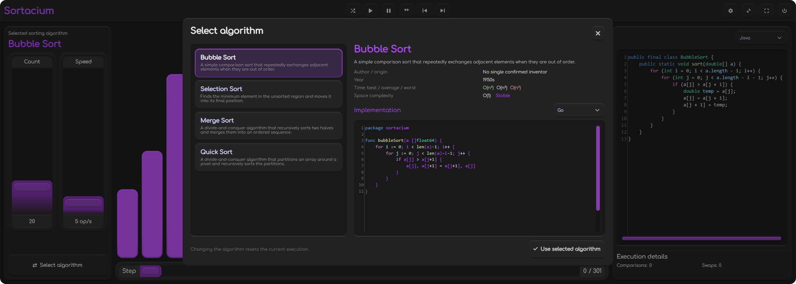
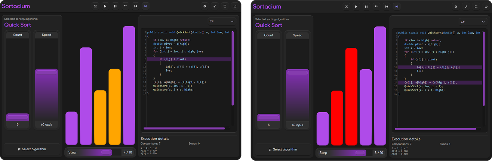
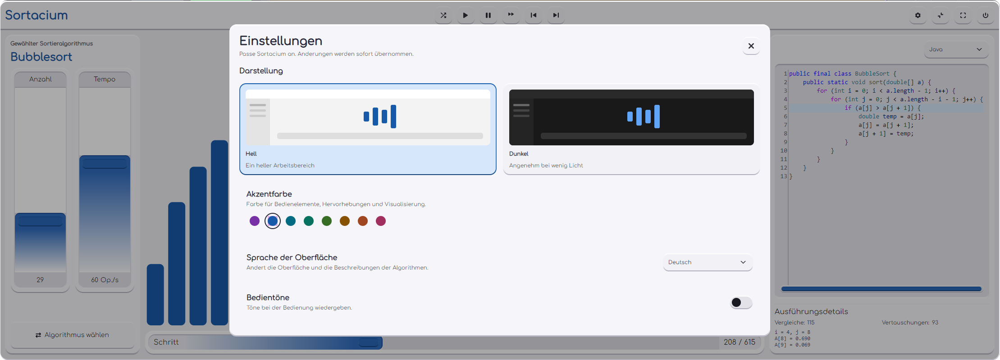

# Sortacium

**Sorting algorithms are easier to understand when you can see what happens at every step.**

Sortacium is a desktop application for visualizing sorting algorithms. It shows how elements are compared and swapped, highlights the relevant parts of the code, and lets you follow the process from the first operation to the last.

I didn't want to build just another animation of bars moving around. I wanted something I could pause, rewind, and explore — a place where I could look at a specific operation and understand *why* it happened. That's the idea behind Sortacium.

The project is built with **C#**, **.NET 10**, and **Avalonia UI**, with **Windows, Linux, and macOS** in mind. It's still a work in progress, and I'm building it step by step.

> **A small note:** Sortacium isn't a benchmark or an attempt to sort arrays as fast as possible. The goal is to make algorithms easier to explore, understand, and learn from.

## A look at Sortacium



## What you can do

- **Control the execution.** Play, pause, step forward, step backward, or jump straight to the end.
- **Explore the timeline.** Move to a specific point in the execution without restarting the algorithm.
- **See each operation.** Comparisons and swaps use different colors, while bar movements are smoothly animated.
- **Experiment with the array.** Generate and shuffle **5–100 elements**, and set the speed from **1 to 100 operations per second**.
- **Follow the code.** Switch between available code representations and see which lines correspond to the current operation.
- **Inspect the details.** Track comparisons, swaps, indices, and element values as the algorithm runs.
- **Browse the algorithm library.** Read descriptions, background information, complexity estimates, stability details, and implementations.
- **Make the interface yours.** Choose a light or dark theme, an accent palette, an interface language, and whether UI sounds are enabled.

## Supported algorithms

Four algorithms are currently implemented:

| Algorithm | Visualization | Available code representations |
| --- | :---: | --- |
| **Bubble Sort** | Yes | Pseudocode, C, C#, C++, Python, Go, Rust, Java, JavaScript, Assembly |
| **Selection Sort** | Yes | Pseudocode, C# |
| **Merge Sort** | Yes | Pseudocode, C# |
| **Quick Sort** | Yes | Pseudocode, C# |

The available languages depend on the algorithm. I'm gradually expanding the collection rather than adding placeholders for implementations that aren't there yet.

### Explore before switching

The algorithm library is more than a list of names. You can select an algorithm, read about it, compare its time and space complexity, check whether it's stable, and browse its code before using it in the visualizer.

Selecting **Use Algorithm** applies your choice and generates a fresh array.



### More than watching bars move

Under the hood, each comparison and swap is recorded as an individual action. That makes it possible to replay the same execution in either direction, inspect a specific moment, or jump to a different step on the timeline.

The code highlighting and execution statistics follow along. For the current operation, you can also inspect the involved indices and values. The point is to understand the decisions an algorithm makes, not just watch it reach the right result.



### An interface with some personality

Sortacium has custom-styled controls and its own bar renderer. There are **light and dark themes** and eight accent palettes: **Violet, Blue, Cyan, Teal, Green, Amber, Orange, and Rose**.

The interface currently supports **English, Russian, Ukrainian, German, and French**. UI interaction sounds can be turned off, and your settings are saved between sessions.



## Getting started

For now, the easiest way to try Sortacium is to run it from source. You'll need **Git** and the **.NET 10 SDK** installed.

1. Clone the repository:

   ```bash
   git clone https://github.com/satisplexity/Sortacium.git
   cd Sortacium
   ```

2. Restore dependencies and start the application:

   ```bash
   dotnet restore Sortacium.slnx
   dotnet run --project Sortacium.Presentation/Sortacium.Presentation.csproj
   ```

To run the tests:

```bash
dotnet test Sortacium.slnx
```

Sortacium is designed as a cross-platform Avalonia application. There are no packaged installers in GitHub Releases yet; development is ongoing.

## How it's built

One decision I wanted to get right from the beginning was keeping the **sorting logic separate from the visualization**. An algorithm shouldn't need to know how a bar is drawn or how the UI is structured.

```text
Sortacium/
├── Sortacium.Core/                # Algorithms, actions, and playback
│   ├── Algorithms/
│   └── Execution/
├── Sortacium.Presentation/        # Avalonia UI and presentation logic
│   ├── Controls/                  # BarsRenderer, code editor, custom controls
│   ├── ViewModels/
│   ├── Views/
│   ├── Services/
│   ├── Themes/
│   └── Resources/                 # Algorithm metadata and localization
├── Sortacium.Presentation.Tests/  # Tests
└── Sortacium.slnx
```

The execution model is fairly straightforward:

1. **Record the operations.** An algorithm takes the initial values and produces a `SortingTrace` containing comparisons and swaps.
2. **Play them back.** `SortingPlayer` moves through the trace forward or backward, updating element order and statistics. Checkpoints make longer jumps through the history more efficient.
3. **Render the result.** `BarsRenderer` draws and animates the bars independently of the sorting algorithms.
4. **Connect code and execution.** `Algorithms.json` stores descriptions, translations, code examples, and mappings between operations and source lines.

It's not about making the architecture complicated. I want to be able to add new algorithms and ways of visualizing them without rebuilding the entire application every time.

### Tech stack

- **C# / .NET 10** — application and algorithm logic
- **Avalonia UI** — cross-platform desktop interface
- **CommunityToolkit.Mvvm** — view models and commands
- **AvaloniaEdit + TextMate** — code display and syntax highlighting
- **SoundFlow** — UI audio feedback
- **xUnit** — tests

## What's next?

There are plenty of things I'd like to add, but the priority is improving how clearly Sortacium shows what's happening — not just collecting features.

- More sorting algorithms and code implementations in additional languages.
- Richer execution traces, with more operation types and better variable inspection.
- Improvements to animations, sound feedback, and customization.
- Better navigation through execution history and more useful code views.
- Packaged releases for supported desktop platforms.

These are directions I'd like to take the project, not promises tied to specific dates. The source code and commit history are the best places to see its current state.

## Contributing and feedback

Sortacium is a personal project I work on as I learn, experiment, and come up with new ideas. If you find a bug, have an idea for improving the interface, or want to suggest a sorting algorithm, feel free to [open an issue](https://github.com/satisplexity/Sortacium/issues).

Suggestions, feedback, and thoughtful discussions about the implementation are welcome.

## License

Sortacium is available under the [MIT License](LICENSE).

---

*Making sorting algorithms a little less abstract, one step at a time.*
